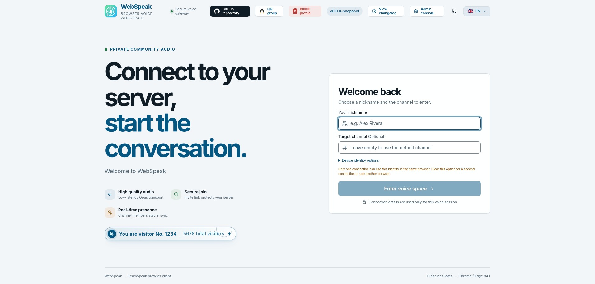
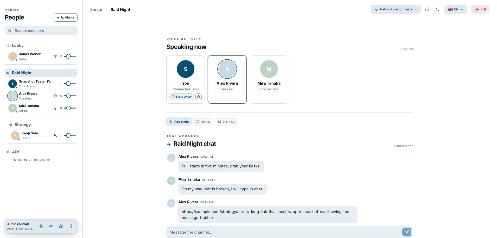
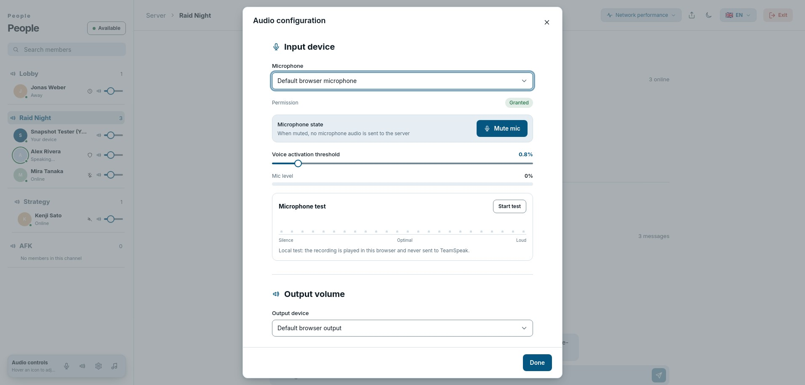
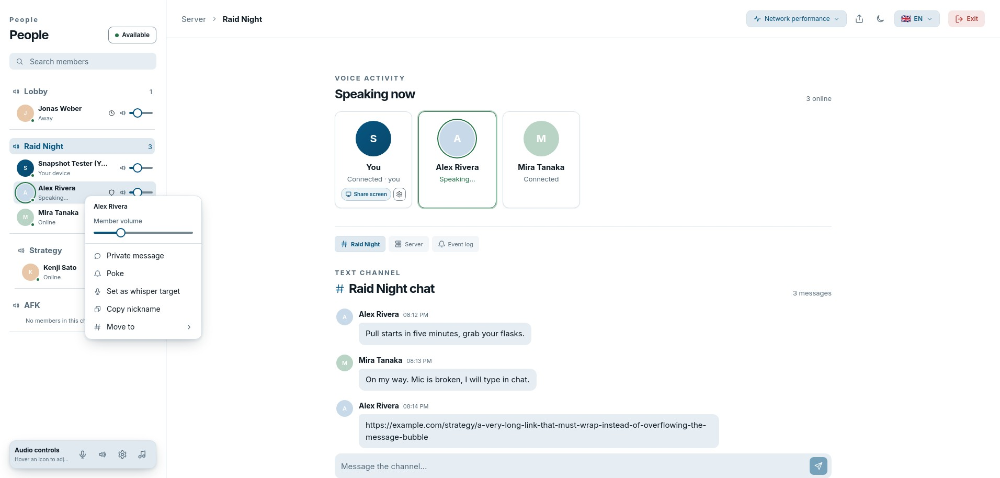

# WebSpeak · English

[Project home](../README.md) · [Deutsch](./README.de.md)

WebSpeak is a self-hosted browser client and voice gateway for TeamSpeak 3 and TeamSpeak 6. Visitors can join channels without installing a desktop client, while administrators manage the target servers, access policy, and runtime state from the web console.

## Live demo

URL: <https://webspeak.online>

The public demo is hosted in Hong Kong and its network conditions and load may be unstable. Latency, disconnections, or temporary downtime do not represent every self-hosted deployment.

## ✨ Features

| Capability | Description |
| --- | --- |
| TeamSpeak compatibility | Supports TeamSpeak 3 and TeamSpeak 6 and automatically detects the target protocol. |
| Cross-platform P2P screen sharing | Browser users and native TeamSpeak 6 clients can start and watch each other's screen shares; WebRTC/ICE carries media directly while WebSpeak relays negotiation signaling only. |
| IPv6 targets | IPv6 TeamSpeak targets and IPv6 addresses resolved from hostnames are supported by default. |
| Channels and members | Browse the channel tree, see live member states, and switch channels. |
| Realtime voice | Opus audio with a compatibility transport and optional bundled WebRTC low-latency transport. |
| Audio controls | Select microphones and speakers, adjust volume, test the microphone, mute, use VOX, and control member volume. |
| Browser-side noise suppression | Optional microphone noise suppression runs at the browser capture stage, without adding server-side audio processing. |
| Messaging and actions | Channel chat, server chat, private messages, poke actions, and whisper targets. |
| Desktop accompaniment | Select an audio-enabled window or browser tab and share its sound with the current channel. |
| Identity and access | Remembered identity, a list of servers visitors pick by name, optional visitor-defined targets, and revocable expiring invite links. |
| Administration | Manage targets, access policy, WebRTC, relays, invites, sessions, logs, diagnostics, and backups. |
| User experience | English and German UI, light/dark themes, and responsive desktop/mobile layouts. |
| Self-hosting | Data stays with the operator; Docker, Windows x64, and Linux x64 deployment options are provided. |

## 🖼️ Screenshots

The screenshots show the English welcome page, voice workspace, audio controls, and member menu.

### Welcome page

<p align="center"></p>

### Voice workspace

<p align="center"></p>

### Audio controls

<p align="center"></p>

### Member menu

<p align="center"></p>

## 🧩 Advanced features

These features are optional. WebSpeak continues to work with the compatibility voice transport when they are disabled. Configure them under **Administration → Servers**; saved changes apply to new connections.

### 1. WebRTC low-latency voice

WebRTC moves browser voice to a realtime media path and also enables desktop accompaniment. The current WebSpeak gateway provides it directly; no separate media server is required.

1. Sign in at `/admin` and open **Advanced settings** on the **Servers** page.
2. While WebRTC is disabled, choose the UDP start and end ports. The default range is `40000–40099`.
3. Allow the complete UDP range in the WebSpeak host's security group and firewall.
4. Enable **WebRTC** and save. New visitors will negotiate WebRTC; unsupported browsers and networks fall back to the compatibility transport.

The port range is locked while WebRTC is enabled. Disable and save WebRTC before changing it, then update the firewall rules. Public deployments also need HTTPS.

### Screen-share ICE candidates

Screen-share media still prefers a direct browser-to-browser path; WebSpeak only relays negotiation signaling. By default it uses TeamSpeak's public STUN services to discover server-reflexive candidates; STUN does not carry media. If the deployment has an authorized external TURN service, set `WEBSPEAK_SCREEN_SHARE_ICE_SERVERS` before starting WebSpeak with a JSON array, for example:

```json
[{"urls":"stun:turn.teamspeak.com:3478"},{"urls":"turns:turn.example.com:5349","username":"<username>","credential":"<credential>"}]
```

With TURN configured, media may use that external TURN service but never the WebSpeak gateway; without it, only direct ICE paths and STUN are used.

### Cross-platform P2P screen sharing

Browser users and native TeamSpeak 6 clients can discover, start, and watch each other's screen shares. Screen media between browsers, and between a browser and a native client, is sent over a WebRTC/ICE peer-to-peer path whenever possible; WebSpeak handles session authorization, share state, and SDP/ICE signaling, but does not carry the screen media. The UI includes live status, viewer count, player volume, fullscreen, and exit controls. Share settings support up to 1080p and 60 FPS, with live WebRTC statistics for diagnosis.

### 2. Relay mode

Use a relay when a TeamSpeak server rejects connections from another region or when the direct path is unstable. It is not a VPN: it forwards only the TeamSpeak traffic of the current WebSpeak session, while the visitor still chooses the target server in the web page.

A relay instance is a dedicated forwarding service with no visitor page or administration console. It accepts only gateway sessions with a matching token. Use a random token of at least 16 characters.

#### Run from source

```bash
git clone --depth 1 https://github.com/Ex0danify/WebSpeak.git
cd WebSpeak
npm ci --ignore-scripts
npm run build:gateway
WEBSPEAK_MODE=relay \
WEBSPEAK_RELAY_TOKEN='replace-with-a-long-random-token' \
WEBSPEAK_RELAY_HOST='0.0.0.0' \
WEBSPEAK_RELAY_PORT='39087' \
WEBSPEAK_RELAY_ALLOW_PRIVATE='0' \
node dist/index.js
```

Windows PowerShell:

```powershell
$env:WEBSPEAK_MODE = "relay"
$env:WEBSPEAK_RELAY_TOKEN = "replace-with-a-long-random-token"
$env:WEBSPEAK_RELAY_HOST = "0.0.0.0"
$env:WEBSPEAK_RELAY_PORT = "39087"
$env:WEBSPEAK_RELAY_ALLOW_PRIVATE = "0"
node .\dist\index.js
```

#### Run from a release package

Download and extract the appropriate package from [Releases](https://github.com/Ex0danify/WebSpeak/releases/latest):

```bash
# Linux
export WEBSPEAK_MODE=relay
export WEBSPEAK_RELAY_TOKEN='replace-with-a-long-random-token'
export WEBSPEAK_RELAY_HOST='0.0.0.0'
export WEBSPEAK_RELAY_PORT='39087'
export WEBSPEAK_RELAY_ALLOW_PRIVATE='0'
./runtime/node ./dist/index.js
```

On Windows PowerShell, set the same variables and run `.\runtime\node.exe .\dist\index.js`.

#### Run with Docker

```bash
docker run -d --name webspeak-relay --restart unless-stopped --network host \
  -e WEBSPEAK_MODE=relay \
  -e WEBSPEAK_RELAY_TOKEN='replace-with-a-long-random-token' \
  -e WEBSPEAK_RELAY_HOST='0.0.0.0' \
  -e WEBSPEAK_RELAY_PORT='39087' \
  -e WEBSPEAK_RELAY_ALLOW_PRIVATE='0' \
  ghcr.io/echosixhiya/webspeak:latest
```

Allow the relay host's UDP listen port, `39087` by default.

#### Enable it in the gateway

1. Open **Administration → Servers → Relay server** and add one or more nodes.
2. Set a custom display name, endpoint such as `relay.example.com:39087`, and matching token for each node, then save.
3. Visitors can choose direct access or one of the configured relays on the welcome page.

Disable and save the relay configuration to remove the relay option from the welcome page.

### 3. Dependencies and attribution

- The relay service is built into WebSpeak with Node.js standard libraries; it does not use GOST, sing-box, or another proxy framework.
- WebRTC uses [werift](https://github.com/shinyoshiaki/werift-webrtc) `0.24.4`, whose upstream project is licensed under MIT.
- Opus audio is encoded and decoded with [libopus](https://opus-codec.org/) `1.5.2` (BSD-3-Clause), built to WebAssembly and bundled in the repository, so no native toolchain is required to install.
- TeamSpeak protocol connectivity uses WebSpeak's own in-repo TeamSpeak client, written from scratch. It builds on the protocol groundwork of the [EchoSixHIYA/teamspeak-js](https://github.com/EchoSixHIYA/teamspeak-js) fork (MIT) and on the public TeamSpeak protocol documentation by the TSDNS/TeamSpeak reverse-engineering community.

## 🧾 Changelog

| Version | Date | Summary |
| --- | --- | --- |
| [v0.2.4](https://github.com/EchoSixHIYA/WebSpeak-client-for-TeamSpeak/releases/tag/v0.2.4) | 2026-09-22 | Added cross-platform P2P screen sharing between browsers and native TeamSpeak 6 clients; added STUN/external-TURN configuration, live player and viewer state, 1080p/60 FPS capture settings, and WebRTC statistics; refined screen-share interactions and added visitor numbering. |
| [v0.2.3](https://github.com/EchoSixHIYA/WebSpeak-client-for-TeamSpeak/releases/tag/v0.2.3) | 2026-09-19 | Added channel member scheduling and permission-aware direct moves; added avatar, mute-state, and remembered-identity support; refreshed feature screenshots and documentation for all five languages. |
| [v0.2.2](https://github.com/EchoSixHIYA/WebSpeak-client-for-TeamSpeak/releases/tag/v0.2.2) | 2026-09-17 | Added browser-side microphone noise suppression, Russian and Japanese UI, and per-language welcome text; refined volume interaction and error messages/codes on top of PR #2. |
| [v0.2.1](https://github.com/EchoSixHIYA/WebSpeak-client-for-TeamSpeak/releases/tag/v0.2.1) | 2026-09-13 | Improved welcome-page connection errors, preserved and safely truncated error codes, and added default IPv6 target support. |
| [v0.2.0](https://github.com/EchoSixHIYA/WebSpeak-client-for-TeamSpeak/releases/tag/v0.2.0) | 2026-09-10 | Added server-password prompts, formal relay mode, multiple relay selection, and administrator connection-reason reporting. |
| [v0.1.8](https://github.com/EchoSixHIYA/WebSpeak-client-for-TeamSpeak/releases/tag/v0.1.8) | 2026-09-08 | Simplified Docker deployment, supported local TeamSpeak targets, added a 15-second connection timeout, and made network monitoring continuous. |
| [v0.1.7](https://github.com/EchoSixHIYA/WebSpeak-client-for-TeamSpeak/releases/tag/v0.1.7) | 2026-09-06 | Added German, Telegram, network performance, and master-volume features; fixed accompaniment volume fluctuation. |
| [v0.1.6](https://github.com/EchoSixHIYA/WebSpeak-client-for-TeamSpeak/releases/tag/v0.1.6) | 2026-09-04 | Added desktop accompaniment, remembered-identity guidance, and the site icon; fixed WebRTC member volume. |
| [v0.1.5](https://github.com/EchoSixHIYA/WebSpeak-client-for-TeamSpeak/releases/tag/v0.1.5) | 2026-09-04 | Fixed identity persistence and refined the theme toggle. |
| [v0.1.4](https://github.com/EchoSixHIYA/WebSpeak-client-for-TeamSpeak/releases/tag/v0.1.4) | 2026-09-03 | Fixed WebRTC and channel chat and refined administration, logs, and mobile layouts. |
| [v0.1.3](https://github.com/EchoSixHIYA/WebSpeak-client-for-TeamSpeak/releases/tag/v0.1.3) | 2026-09-03 | Added bundled WebRTC, migrated the TeamSpeak SDK, and improved member synchronization and voice buffering. |

See the complete history on the [releases page](https://github.com/Ex0danify/WebSpeak/releases).

## 🚀 Deployment

| Method | Best for | Environment |
| --- | --- | --- |
| Docker Compose (recommended) | Long-running servers, simple upgrades, and persistent data | Docker Engine + Docker Compose |
| Release package | Running without Node.js or build dependencies | Windows x64 or Linux x64 |
| From source | Development, debugging, and customization | Node.js 22.5+, Git, and native build tools |

### Docker Compose (recommended)

```bash
git clone --depth 1 https://github.com/Ex0danify/WebSpeak.git
cd WebSpeak
cp .env.example .env
# edit .env and set WEBSPEAK_ADMIN_PASSWORD (at least 12 characters)
mkdir data
docker compose up -d --build
```

WebSpeak refuses to start on a fresh database until `WEBSPEAK_ADMIN_PASSWORD` is set; if the container keeps restarting, check `docker compose logs webspeak`. Open `http://<your-host>:3040` after startup (the port is `WEBSPEAK_PORT`). If using a reverse proxy, point it to that address. When WebRTC is enabled, allow the UDP range shown in the administration console. Data is stored in `WEBSPEAK_DATA_DIR` (`./data` next to `docker-compose.yml` by default); create it before the first start, the container runs as `WEBSPEAK_UID`:`WEBSPEAK_GID` from `.env` (1000 by default, `id -u` and `id -g` show yours) and must be able to write to it.

```bash
docker compose ps
docker compose logs -f webspeak
```

Upgrade:

```bash
git pull --ff-only
docker compose up -d --build
```

To back up, stop the container and copy `data/` (database and `master.key` belong together).

### Release package

Download the matching `windows-x64.zip` or `linux-x64.tar.gz` from [GitHub Releases](https://github.com/Ex0danify/WebSpeak/releases/latest), extract it into a dedicated directory, copy `.env.example` to `.env`, set `WEBSPEAK_ADMIN_PASSWORD` in it, and run `start-webspeak.cmd` on Windows or `./start-webspeak.sh` on Linux. Packages include the Node.js runtime and production dependencies.

### From source

```bash
git clone https://github.com/Ex0danify/WebSpeak.git
cd WebSpeak
npm ci --ignore-scripts
npm --prefix web ci
npm run build
cp .env.example .env   # then set WEBSPEAK_ADMIN_PASSWORD in it
npm start
```

### First-time setup

1. Open `http://<your-host>:3040/admin`.
2. Sign in with `WEBSPEAK_ADMIN_USERNAME` and the `WEBSPEAK_ADMIN_PASSWORD` from your `.env`, then set a new password of at least 12 characters. That `.env` value only creates the account on a fresh database; changing it later has no effect, and you can remove it once you have signed in.
3. Add your TeamSpeak servers under **Servers**, for example `voice.example.com:9987`, and choose the access mode. Visitors pick a server by name and never see its address, so a server on a LAN or loopback address is reachable for visitors without opening the gateway to those networks. Open access additionally lets visitors type a public address.
4. Configure HTTPS for public access; when WebRTC is enabled, allow the UDP range shown in the console.

### Configuration: `.env` and the admin console

`.env` (copied from [`.env.example`](../.env.example), which also holds every default) holds the deployment settings the process needs before it can serve anything: the bootstrap admin account, `WEBSPEAK_HOST`, `WEBSPEAK_PORT`, `WEBSPEAK_DATA_DIR`, `WEBSPEAK_TRUST_PROXY`, `WEBSPEAK_SCREEN_SHARE_ICE_SERVERS` and the relay variables. WebSpeak has no built-in defaults: it refuses to start if a variable is not set at all (an empty value is fine where `.env.example` leaves it empty). A variable set in the real environment wins over `.env`. Everything an administrator manages (TeamSpeak servers and their passwords, access mode, WebRTC, relays, site texts) lives in the admin console. The old `config.json` is no longer read.

### Lost administrator password

Run the reset command on the host or inside the container. It asks for a new password (at least 12 characters, hidden, asked twice), requires a change at the next sign-in and signs out every admin session. Add `--username <name>` to change the username as well.

```bash
docker compose exec webspeak node dist/index.js reset-admin-password   # Docker
npm run admin:reset-password                                            # release package or source
```

## ⚠️ Requirements and notes

| Area | Requirement or note |
| --- | --- |
| Browser | Use a current Chrome, Edge, or other modern browser with WebRTC support. Microphone and window audio normally require HTTPS. |
| TeamSpeak network | The WebSpeak host must reach the target TeamSpeak server; the default voice port is `9987`. |
| Web network | The service uses `3040/TCP` by default (`WEBSPEAK_PORT`); public deployments should expose the page and WebSocket through an HTTPS reverse proxy. |
| IPv6 | Write literal targets as `[2001:db8::1]:9987`. The host/container needs routed IPv6, IPv6 enabled in the OS and Node.js, and the relevant firewall rules. |
| WebRTC | The default range is `40000–40099/UDP`; allow it and disable WebRTC before changing the range. |
| Remembered identity | One browser identity can hold one active remembered connection. Disable it for parallel connections or use another browser profile. |
| Accompaniment | Desktop only and requires WebRTC. Enable audio sharing when selecting a window or tab. |
| Data | Docker, release packages and source installs all use `data/`. Back up before upgrades. |
| Session limit | One instance accepts up to 100 active browser sessions. |
